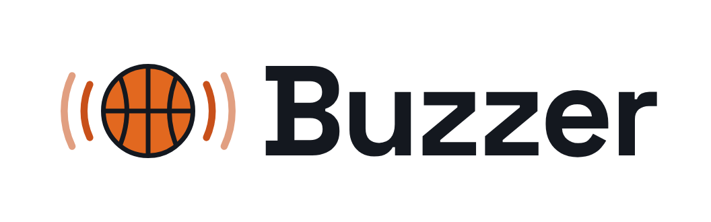
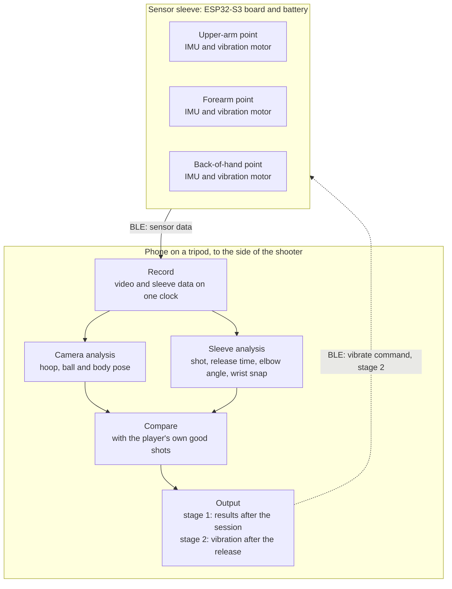

**A sensor sleeve and a phone camera for basketball shooting feedback.**

Final engineering project at the Hebrew University of Jerusalem, course 67547 (Engineering Project and Workshops II), Group 106.

Team: Morel Avraham, Barak Kappah, Eitan Simckes. Mentor: Daniella Har Shalom.

Project page: [Notion workspace](https://app.notion.com/p/Buzzer-Group-106-67547-03f3bbd7caaa8320b7b60121d3fc1436)

---

## What Buzzer is

Shooting technique decides how well a basketball player scores. A professional has a coach who watches every shot. A player who practises alone has no one, and the only feedback is whether the ball went in.

Buzzer gives that player feedback on technique with two low-cost parts:

- **A sensor sleeve** on the shooting arm. It has three sensor points: upper arm, forearm and back of the hand. Each point has an IMU (a small motion sensor) and a small vibration motor. One ESP32-S3 board on the sleeve reads the three IMUs and talks to the phone over Bluetooth Low Energy (BLE).
- **A phone camera** on a tripod, to the side of the shooter. It finds the hoop and follows the ball. The rim is 3.05 m above the floor, and this known height turns pixels into metres.

An Android app records both on one clock and shows the results shot by shot. Each measure is compared with the player's own good shots (the ones that went in), not with one ideal form.

## Who measures what

| Measure | Camera | Sleeve | Note |
|---|---|---|---|
| Made or missed | Yes | No | The sleeve does not see the ball. |
| Release height | Yes | No | In metres, with the rim height as the scale. |
| Arc of the ball | Yes | No | |
| Legs and back posture | Yes | No | From a body pose model. |
| Release time | Yes | Yes | Camera: one frame every 33 ms. Sleeve: expected to be more exact. |
| Elbow angle | Check only | Yes | The video checks the sleeve. |
| Wrist snap | No | Yes | Too fast for 30 pictures per second. |
| Vibration feedback | No | Yes | Stage 2 only. |

The camera values are also the labels that train and test the sleeve models.

## How it fits together



In stage 1 the two analysis steps run on a laptop after the session. In stage 2 they run on the phone during practice.

## Offline first, then real time

Moving from offline to real time is the core of the project and the hardest part. We start offline on purpose. Offline we can check every measure against the video and reach small, clear goals one by one.

| Stage | Until | What |
|---|---|---|
| Stage 1, offline | January 2027 | One sensor and the camera. The analysis runs on a laptop after the session. |
| Stage 2, real time | June 2027 | The full sleeve. The same analysis runs on the phone during practice, and the sleeve vibrates right after the release at the joint that moved differently. |

Out of scope: games, defended shots and more than one player in the picture.

## Roadmap

**First steps (November to December 2026)**

1. Equipment. Buy all the parts for the first sleeve, and a tripod.
2. App. Build the Android app that records the video and one hand sensor on one clock.
3. Video model. Film free throws from the side and train the model that finds the ball and the hoop.

**MVP, the skateboard (demo day, January 2027).** One sensor on the hand and the camera, free throws only, all analysis offline. For every shot we show the release time, the release height, made or missed, and the wrist snap speed.

**Must have, the bike (June 2027).** The full sleeve with three sensors and the elbow and wrist angles, first offline. Then the analysis moves to the phone and the sleeve vibrates after the release. Our own board is designed in parallel, and the development board is the backup. A test with eight shooters.

**Stretch, the car.** More shot types, and shot detection on the sleeve itself.

## First targets

These are targets, not results. We will update them after the first tests.

| What we measure | Minimum | Target |
|---|---|---|
| Shots found by the sleeve | 90% | 97% |
| Release time against slow-motion video | 50 ms | 20 ms |
| Release height against a marked height | 10 cm | 5 cm |
| Made or missed against hand labels | 90% | 97% |
| Elbow angle against a goniometer | 10° | 5° |
| Stage 2: delay from release to vibration | 1 s | 0.5 s |
| Stage 2: player names the vibrating point | 85% | 95% |

## Status

- [x] Project proposal approved
- [x] Project changed from a barbell strength coach to basketball shooting (November 2026)
- [ ] Course Milestone 1: preliminary report (due 17 November 2026)
- [ ] Equipment for the first sleeve
- [ ] App that records the video and one sensor on one clock
- [ ] Model that finds the ball and the hoop
- [ ] MVP for demo day (January 2027)

No Buzzer measurements exist yet. Every number in this README is a target or an estimate.

## Repository layout

```
Buzzer/
├── app/        Android app (Kotlin). See the note below.
├── docs/       Protocol and data notes, and the logo
├── .github/    Build and test workflow for app/
└── README.md
```

**About `app/`.** The code in `app/` was written for the earlier version of this project, a barbell strength coach called CoachPocket. Its package names, its README and the two files in `docs/` still describe that version. We keep it because Buzzer needs the same building blocks, and we will adapt them step by step:

- the BLE packet decoder and the loss counters (`app/core/.../protocol`)
- the alignment of the sensor clock with the phone clock (`app/core/.../sync`)
- the session recorder (`app/mobile/.../record`)
- the camera and body pose pipeline with CameraX and MediaPipe (`app/mobile/.../camera`)

The squat analysis and the voice cues are not part of Buzzer and will be removed.

Folders that will be added when the work starts: `firmware/` (ESP32-S3, ESP-IDF), `hardware/` (board design in KiCad, parts list), `vision/` (Python: ball and hoop detector, body pose) and `analysis/` (Python: stage 1 offline analysis).

## Getting started

### Clone

```bash
git clone https://github.com/MorelAvraham/Buzzer.git
cd Buzzer
```

### Android app

You need JDK 17 or newer. The Gradle wrapper downloads the rest. The exact versions are in [app/README.md](app/README.md).

```bash
cd app
./gradlew :core:test :tools:test   # logic tests, no Android SDK or phone needed
./gradlew :mobile:assembleDebug    # builds the APK, needs the Android SDK
./gradlew :mobile:installDebug     # installs on a phone with USB debugging on
```

You can also open the `app/` folder in Android Studio. Every pull request that touches `app/` runs the tests and the build in GitHub Actions.

### Python (stage 1 analysis)

Not in the repository yet. When `vision/` and `analysis/` are added, each one gets its own README with a `requirements.txt` and the commands to run it. The planned tools are Python with OpenCV, MediaPipe Pose and PyTorch.

### Firmware

Not in the repository yet. The planned tool is ESP-IDF for the ESP32-S3.

## Parts and cost

Prices are from the suppliers' websites in November 2026, without shipping. Lines marked * are our estimates.

| Part | What we use | Cost |
|---|---|---|
| Sleeve board | [Seeed XIAO ESP32S3](https://www.seeedstudio.com/XIAO-ESP32S3-p-5627.html) | about $8 |
| Sensors | Three [LSM6DSV16X](https://www.st.com/en/mems-and-sensors/lsm6dsv16x.html) IMUs on [SparkFun boards](https://www.sparkfun.com/sparkfun-6dof-imu-breakout-lsm6dsv16x-qwiic.html) | about $25 each |
| Vibration | Three small coin vibration motors | about $3 each |
| Battery, sleeve, cables | A small lithium battery, a compression arm sleeve, thin cables | about $30 * |
| Tripod | A phone tripod | about $15 * |
| Our own board | KiCad for the design, an online manufacturer for the board | about $20 * |

The MVP with one sensor costs about $80 in parts, and one full sleeve about $140.

## Contributing

- Each member commits their own work from their own GitHub account.
- Work on one branch per task (for example `app/record-one-clock` or `vision/ball-detector`) and merge to `main` through a pull request.
- Commit messages describe the change, for example `app: record video and sensor data on one clock`.
- Do not commit videos or raw recordings. Volunteers sign a consent form, and the video stays on our devices.
- Tasks, schedule and requirements are in the [Notion workspace](https://app.notion.com/p/Buzzer-Group-106-67547-03f3bbd7caaa8320b7b60121d3fc1436).

The division of work between the team members is not fixed yet. We will decide it together during the first steps and write it in the Notion task list.

## Project history

The project started in August 2026 as CoachPocket, a barbell strength coach with a wrist sensor and a phone camera. In November 2026 it changed to basketball shooting and was renamed Buzzer.
