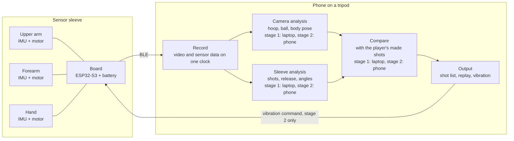

# Buzzer

Buzzer gives basketball players feedback on their shooting technique while they practise alone. The player wears a sensor sleeve on the shooting arm and puts a phone on a tripod to the side. The sleeve measures the arm, the camera measures the ball and the body, and the phone app shows each shot and marks what was different from the player's own made shots. It is for players who train alone, without a coach.

Final engineering project, Hebrew University of Jerusalem, course 67547, group 106.

## The system



More detail in [docs/architecture.md](docs/architecture.md).

## Who measures what

| Measure | Camera | Sleeve |
|---|---|---|
| Made or missed | Yes | No |
| Release height | Yes, in metres | No |
| Arc of the ball | Yes | No |
| Legs and back posture | Yes, from a body pose model | No |
| Release time | Yes, one frame every 33 ms | Yes, expected to be more exact |
| Elbow angle | Check only | Yes |
| Wrist snap | No | Yes |
| Vibration feedback | No | Yes, stage 2 only |

The camera values are also the labels used to train and test the sleeve models. More in [docs/measures.md](docs/measures.md).

## Offline first, then real time

- **Stage 1, offline (until January 2027):** one sensor on the hand and the camera. The analysis runs on a laptop after the session, in Python.
- **Stage 2, real time (until June 2027):** the full sleeve with three sensors. The same analysis runs on the phone during practice, and the sleeve vibrates right after the release at the joint that moved differently.

## Repository map

| Folder | What is in it |
|---|---|
| [analysis/](analysis/) | Stage 1 Python analysis: one session in, one row per shot out |
| [vision/](vision/) | Python video analysis: body pose script, plan for the ball and hoop detector |
| [app/](app/) | Android app in Kotlin (project skeleton only so far) |
| [firmware/](firmware/) | ESP32-S3 firmware in ESP-IDF, draft BLE packet format (plan only so far) |
| [hardware/](hardware/) | Sleeve hardware and the bill of materials |
| [models/](models/) | Where trained models are described, and the LiteRT export for the phone |
| [data/](data/) | Data policy, file names and CSV columns. No data in Git |
| [docs/](docs/) | Architecture, measures, open questions, decision log, course reports |

## Setup

Clone the repository:

```bash
git clone https://github.com/MorelAvraham/Buzzer.git
```

Then follow the README of the part you work on.

### Python (analysis and vision)

Python 3.10 or newer. Each folder has its own virtual environment.

```bash
cd analysis
python3 -m venv .venv
source .venv/bin/activate
pip install -r requirements.txt
python shots_from_session.py --sensor sample/synthetic_hand.csv --frames sample/synthetic_frames.csv --out out/synthetic_shots.csv
```

For `vision/`, do the same in that folder, and download the pose model as described in [vision/README.md](vision/README.md).

### Android (app)

Install the latest stable Android Studio from https://developer.android.com/studio, then the latest Android SDK Platform and Platform-Tools from its SDK Manager. Turn on USB debugging on the phone. Build steps are in [app/README.md](app/README.md).

### Firmware

ESP-IDF v5.5 for the ESP32-S3. Full install steps are in [firmware/README.md](firmware/README.md). Once the project exists:

```bash
cd firmware/sleeve
idf.py set-target esp32s3
idf.py build
idf.py -p /dev/ttyACM0 flash monitor
```

## Roadmap

**MVP, the skateboard (demo day, January 2027).** One sensor on the hand and the camera, free throws only, all analysis offline on a laptop. For every shot: release time, release height, made or missed, and the wrist snap speed. No real-time feedback.

**Must have, the bike (June 2027).** The full sleeve with three sensors and the elbow and wrist angles, first offline. Then the analysis moves to the phone and the sleeve vibrates after the release. Our own board is designed in parallel, and the development board is the backup. A test with eight shooters.

**Stretch, the car.** More shot types, and shot detection on the sleeve itself.

Out of scope: games, defended shots, more than one player in the picture.

### First targets

These are targets, not results. Nothing has been measured yet.

| Measure | Minimum | Target |
|---|---|---|
| Shots found by the sleeve | 90% | 97% |
| Release time, error against slow-motion video | 50 ms | 20 ms |
| Release height, error | 10 cm | 5 cm |
| Made or missed, correct | 90% | 97% |
| Elbow angle, error | 10 degrees | 5 degrees |
| Stage 2 delay from release to vibration | 1 s | 0.5 s |

The open questions behind these targets, U1 to U6, are in [docs/experiments.md](docs/experiments.md). Decisions are in [docs/decisions.md](docs/decisions.md).

## Team

Morel Avraham, Barak Kappah, Eitan Simckes.

Mentor: Daniella Har Shalom.

- Project page: [Notion](https://app.notion.com/p/Buzzer-Group-106-67547-03f3bbd7caaa8320b7b60121d3fc1436)
- Course reports: [docs/milestone-1/](docs/milestone-1/)
- How we work: [CONTRIBUTING.md](CONTRIBUTING.md)

## Status

- [x] Topic changed to basketball shooting, and the plan written (November 2026)
- [ ] Course Milestone 1: preliminary report
- [ ] Parts for the first sleeve bought
- [ ] App records the video and one hand sensor on one clock
- [ ] Open questions U1 and U2 answered
- [ ] MVP demo (January 2027)
- [ ] Final exhibition (June 2027)

## Project history

Started in August 2026 as CoachPocket, a barbell strength coach, and changed to basketball in November 2026.
