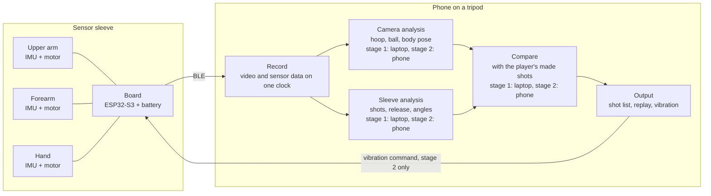

# Architecture

Buzzer has three parts. The sensor sleeve measures the arm. The phone camera measures the ball and the body. The phone app records both on one clock and shows the results.

## Diagram

## Where each block runs

| Block | Stage 1, offline (until January 2027) | Stage 2, real time (until June 2027) |
|---|---|---|
| Sleeve | One IMU on the hand, no motors | Three IMUs and three motors |
| Record | Phone app | Phone app |
| Camera analysis | Laptop, Python, after the session | Phone, during practice |
| Sleeve analysis | Laptop, Python, after the session | Phone, during practice |
| Compare | Laptop, Python, after the session | Phone, during practice |
| Output | Files and plots on the laptop | Shot list and replay in the app, vibration on the sleeve |

## Data flow in stage 1

1. The phone app connects to the sleeve over BLE.
2. The app records the video and the hand sensor on the phone clock.
3. The app exports the video and a sensor CSV.
4. On a laptop, `vision/` turns the video into a per-frame CSV.
5. On a laptop, `analysis/` matches the two CSVs by time stamp and writes one row per shot.

## Data flow in stage 2

The same steps run on the phone while the player practises. Right after the release the phone sends a vibration command to the sleeve, at the joint that moved differently from the player's made shots. The trained models are exported to LiteRT for the phone. See [models/README.md](../models/README.md).

## Related files

- [measures.md](measures.md): which part measures what
- [experiments.md](experiments.md): the open questions U1 to U6
- [firmware/README.md](../firmware/README.md): the draft BLE packet format
